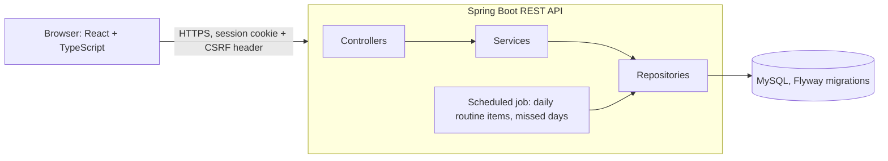

# DayPilot AI

A personal productivity web app that combines a fixed daily timetable, flexible tasks and a job application tracker.
Built as a full-stack project: React + TypeScript frontend, Spring Boot REST API, MySQL database.

## What works today

| Feature | Details |
|---|---|
| Accounts | Register, sign in, sign out. BCrypt password hashing, HttpOnly session cookie, CSRF protection |
| Data isolation | Every query is filtered by the signed-in user. Another user's record returns 404 |
| Routines | A routine is a template. Each day gets its own item (idempotent generator, unique key on routine + date). Completing one day never completes another. Editing a routine changes future days only, history is kept |
| Tasks | Create, edit, complete, reopen, postpone (later dates only), delete. Filters by status, priority, category, due date and search. Overdue list. Full change history per task |
| Job applications | Status pipeline (interested, applied, assessment, interview, offer, rejected, withdrawn, on hold) kept separate from the event history (rounds, deadlines, follow-ups). Upcoming events and follow-ups due |
| Dashboard, My Day, Calendar, Insights | Calculated from your stored data. No sample numbers |
| Responsive layout | Sidebar on laptop, bottom navigation on phone, dark mode |

## Demo or not built yet

| Feature | State |
|---|---|
| Gmail monitoring and AI email classification | **Not built.** The Email Assistant page shows sample emails to demonstrate the review workflow. Nothing is read from an inbox |
| Google Calendar sync | **Not built.** The sync button is a demonstration |
| AI planner | Rule-based (priority, due date, free time). **No AI model is called** |
| Reminders and push notifications | Not built. Notifications shown in the app are local to the browser |
| Deployment | Not done. Runs locally |

## Architecture



* Layers: controller, service, repository, DTOs. Business rules live in services.
* Database changes are Flyway migrations (`V1` to `V5`). Hibernate only validates the schema.
* The frontend shows a change at once, sends it to the API, then reloads from the server.

## Run locally (Windows)

1. **MySQL:** create a database `daypilot` and a user with rights on it (and `daypilot_test` for tests).
2. **Backend** (PowerShell, in `backend/`):

```powershell
$env:DB_USERNAME="your_db_user"
$env:DB_PASSWORD="your_db_password"
.\mvnw.cmd spring-boot:run
```

3. **Frontend** (second PowerShell window, in `frontend/`):

```powershell
npm install
npm run dev
```

4. Open http://localhost:5173 and register.

## Tests

* Backend: `.\mvnw.cmd test` runs the integration tests (authentication, cross-user access, routines, tasks, job applications) against the `daypilot_test` database.
* Frontend: `npm test` runs 22 unit tests for the API client and data mappers. `npm run lint` type-checks the code.

## Security notes

* Passwords are hashed with BCrypt and never returned by the API.
* The session cookie is HttpOnly, and writes need a matching CSRF token.
* Input is validated on the server. Job links must start with `http://` or `https://`.
* Secrets come from environment variables. No credentials are committed.

## Known limitations

* The backend keeps sessions in memory, so a restart signs everyone out.
* Login has no rate limiting yet.
* Routine days are loaded for 30 days back and 30 days ahead in the UI.
* Work mode, salary range and recruiter phone on an application are stored in the browser, not the database.

## Roadmap

1. Gmail read-only connection, with an LLM that classifies job emails and proposes status changes for you to approve.
2. Google Calendar events for confirmed interviews.
3. Reminders (in-app first, then web push).
4. Link tasks to applications, rate limiting, and deployment.